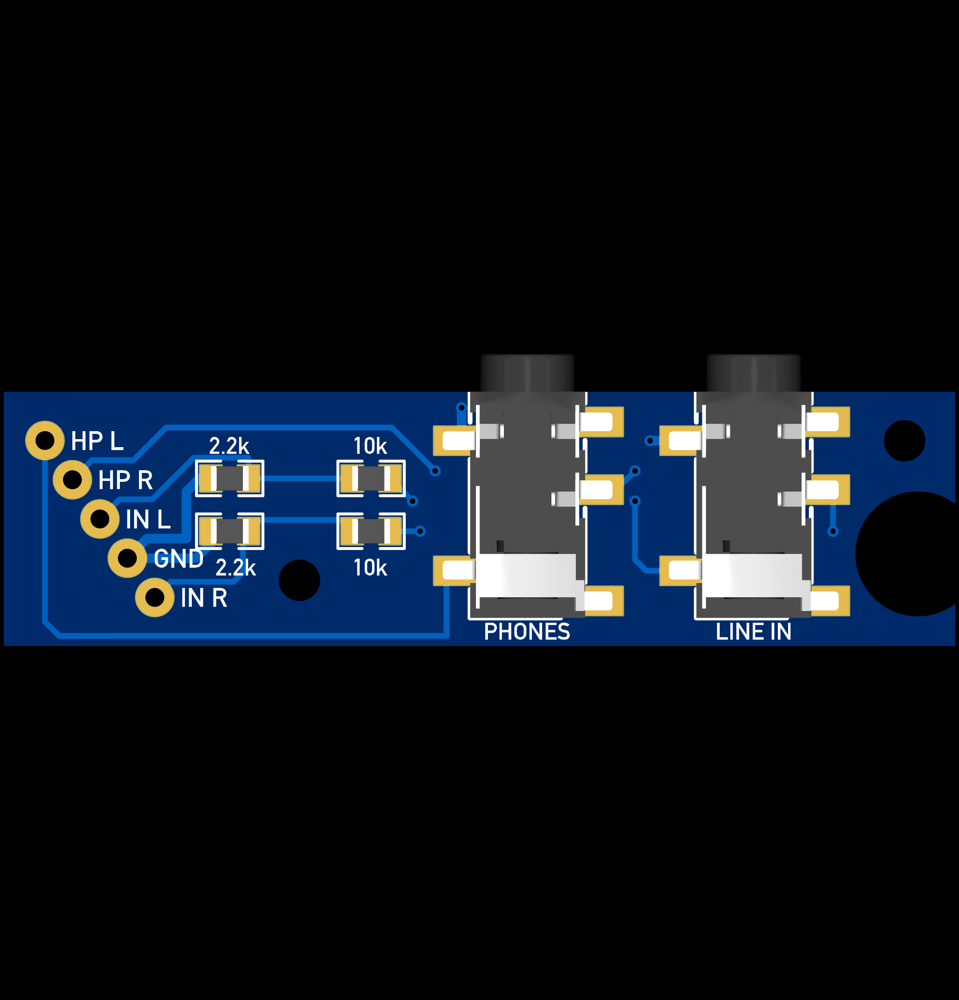
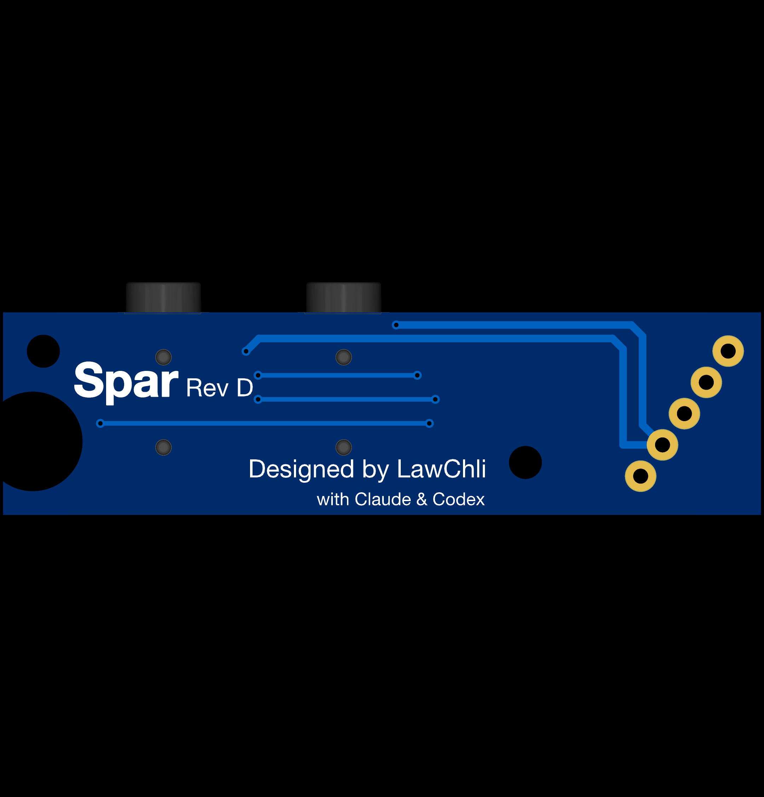

# Spar PCB — Rev D

**Spar Rev D**, redrawn natively in EasyEDA Pro: **50.5 × 13.5 × 1.6 mm**, 2 layers, 0805 resistors, everything hand-solderable. The name comes from Iceland spar, the crystal that splits one image into two, as the board splits one 5-pole jack into monitoring and stereo recording.

## Circuit

The board is passive. A 5-pole plug goes into the phone; its poles are counted from the tip:

| Pole | Function | Connection |
|---|---|---|
| 1 | Left headphone | headphone jack tip |
| 2 | Right headphone | headphone jack ring |
| 3 | Left microphone | line-in tip through 10 kΩ, 2.2 kΩ to ground |
| 4 | Ground | both sleeves, star point |
| 5 | Right microphone | line-in ring through 10 kΩ, 2.2 kΩ to ground |

The 2.2 kΩ resistors give each microphone contact the DC load the phone needs to detect a headset microphone; the 10 kΩ series resistors drop line level to microphone level. Every ground branch (both jack sleeves and both 2.2 kΩ resistors) returns separately to the single ground pad of the plug wires, and neither copper layer has a pour. Background: [software/docs/STEREO-CAPTURE.md](../../../blob/software/software/docs/STEREO-CAPTURE.md).

## Board

Coordinates from the top-left corner of the component side, X right, Y down, in mm.

| Feature | Position |
|---|---|
| Jack axes (J1, J2) | (27.8, 6) and (39.8, 6), 12 mm apart |
| M2 mounting holes | (15.7, 10) and (47.8, 2.6): 2.2 mm non-plated, 2.6 mm copper keep-out radius on both sides |
| Lid-post notch | right edge, centre (48.5, 8.6), 6.6 mm cut-out, 7.2 mm keep-out |
| Wire pads | five pads at 2.54 mm pitch on a 55° row, one ground pad |

Checks in EasyEDA Pro: strict DRC 0 errors and 0 unrouted, 51 tracks, 8 vias, no copper pours; all 23 pins match the frozen netlist; four independent ground branches at the ground pad; minimum clearance between different nets 0.262 mm. Back silkscreen: Spar, Rev D.

Mounting: two flat low-profile M2 screws from the front with 0.5 mm nylon washers under the heads, nuts at the back.

## Files

| Path | Contents |
|---|---|
| `easyeda/Spar-RevD-layout.epro2` | Complete EasyEDA Pro project (schematic, PCB and libraries); import it in EasyEDA Pro |
| `easyeda/Spar-FivePole-Wires.elibz2` | Library for the five-wire pad component |
| `easyeda/Spar-RevD-layout.epcb` | PCB source (JSON) |
| `easyeda/*.enet` | Netlists exported from the PCB and the schematic |
| `previews/` | Renders exported from EasyEDA Pro |
| `BOM.csv` | Parts for one board |

Fabrication files (Gerbers, drill files) will be added when the board is ordered. If the manufacturer's review requires changes, they will become Rev E.

## Revisions

Each revision replaces the previous one on this branch; earlier ones are kept as tags.

| Tag | Date | Revision |
|---|---|---|
| [`pcb-breadboard`](../../../tree/pcb-breadboard/pcb) | 2026-10-11 | Breadboard / hand-wired build |
| [`pcb-rev-a`](../../../tree/pcb-rev-a/pcb) | 2026-10-13 | Cable splitter board, 35 × 15 mm (KiCad) |
| [`pcb-rev-b`](../../../tree/pcb-rev-b/pcb) | 2026-10-15 | Direct-plug board, 48 × 13.5 mm (KiCad) |
| [`pcb-rev-b-m2`](../../../tree/pcb-rev-b-m2/pcb) | 2026-10-16 | Rev B with two M2 mounting holes (KiCad) |
| [`pcb-rev-c-m2`](../../../tree/pcb-rev-c-m2/pcb) | 2026-10-18 | Jacks grouped next to the plug (KiCad) |
| [`pcb-rev-d`](../../../tree/pcb-rev-d/pcb) | 2026-10-20 | Spar Rev D, redrawn in EasyEDA Pro |
