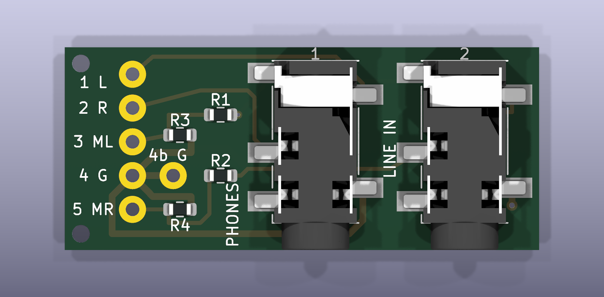

# Spar PCB — Rev A

Cable splitter board: **35 × 15 mm, 2 layers, 1.0 mm**. The 5-pole cable is soldered directly to the board, and two surface-mount 3.5 mm jacks carry the headphone output and the line input. Generated and checked with KiCad 10.0.6 on 2026-10-13: ERC and DRC clean, star ground and resistor paths verified.

Open `xz1-splitter/xz1-splitter.kicad_pro`. Symbols and footprints are in the project's own `lib/`.

## Circuit

The board is passive. A 5-pole plug goes into the phone; its poles are counted from the tip:

| Pole | Function | Connection |
|---|---|---|
| 1 | Left headphone | headphone jack tip |
| 2 | Right headphone | headphone jack ring |
| 3 | Left microphone | line-in tip through 10 kΩ, 2.2 kΩ to ground |
| 4 | Ground | both sleeves, star point |
| 5 | Right microphone | line-in ring through 10 kΩ, 2.2 kΩ to ground |

The 2.2 kΩ resistors give each microphone contact the DC load the phone needs to detect a headset microphone; the 10 kΩ series resistors drop line level to microphone level. Every ground branch (both jack sleeves and both 2.2 kΩ resistors) returns separately to the single ground pad of the plug wires, and neither copper layer has a pour. Background: [software/docs/STEREO-CAPTURE.md](../../../blob/software/software/docs/STEREO-CAPTURE.md).

## Fabrication

`fab/` holds the Gerber archive, `BOM.csv` and the placement file `CPL.csv`, prepared for JLCPCB (FR-4, 2 layers, 1.0 mm, 1 oz copper, top-side SMT). Check jack orientation in the manufacturer's placement preview before ordering. This revision was not fabricated.

| Ref | Part | LCSC |
|---|---|---|
| J1, J2 | XKB PJ-327A0-SMT, 3.5 mm TRS socket | C381135 |
| R1, R2 | 10 kΩ 1 %, 0603 | C25804 |
| R3, R4 | 2.2 kΩ 1 %, 0603 | C4190 |

The five plug wires are soldered to pads W1; they are not a connector.

## Rebuilding

The project was generated and checked with KiCad 10 and its bundled Python:

- `build_design.py` generates the schematic, footprints and board. Its 3D-model step needs the jack's EasyEDA model, which is not redistributed here, so the jack has no 3D model in this repository; the board files open and check without it.
- `release.py` runs ERC and DRC and exports the Gerbers, BOM, placement file and renders. Set `KICAD_CLI` and `KICAD_PYTHON` if KiCad is not in its default macOS location.
- `verify_design.py` independently checks the star ground, the resistor paths and the clearances against the exported netlist.

The jack footprint was drawn from the manufacturer's top-view drawing (XKB PJ-327A0-SMT, LCSC C381135). The 0603 resistor footprint and 3D model come from the KiCad library (CC BY-SA 4.0 with the KiCad design exception).

## Files

| Path | Contents |
|---|---|
| `xz1-splitter/` | KiCad project and local library |
| `fab/` | Gerbers, BOM, placement |
| `previews/` | KiCad renders, copper views, schematic |
| `reports/` | ERC, DRC, drill report, netlist, independent design audit, release checksums |
| `build_design.py`, `release.py`, `verify_design.py` | Generator, release and check scripts |

## Revisions

Each revision replaces the previous one on this branch; earlier ones are kept as tags.

| Tag | Date | Revision |
|---|---|---|
| [`pcb-breadboard`](../../../tree/pcb-breadboard/pcb) | 2026-10-11 | Breadboard / hand-wired build |
| [`pcb-rev-a`](../../../tree/pcb-rev-a/pcb) | 2026-10-13 | Cable splitter board, 35 × 15 mm (KiCad) |
