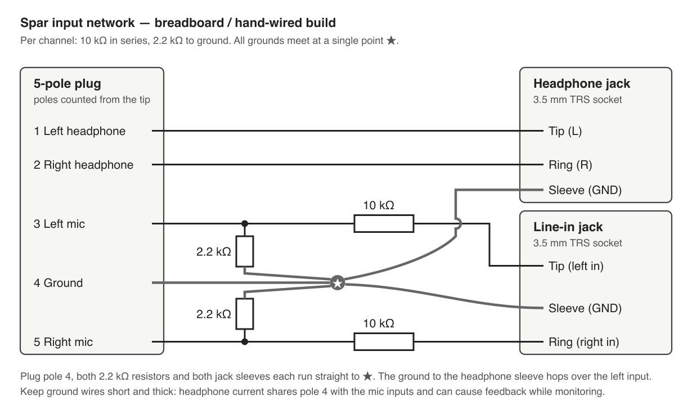

# Breadboard / hand-wired build

This is the same circuit as the Spar board, with the final values. It is how the input network was developed and is a quick way to try Spar without ordering a PCB.

## Parts

| Qty | Part |
|---|---|
| 1 | 5-pole 3.5 mm plug with wire terminals (or a cable cut from a 5-pole headset) |
| 2 | 3.5 mm stereo (TRS) sockets: one for headphones, one for the line input |
| 2 | 10 kΩ resistors |
| 2 | 2.2 kΩ resistors |

## Notes

- Check the plug's pole order with a multimeter before wiring; poles are counted from the tip.
- Use a real stereo socket for the line input. Many PC headset splitters wire the microphone socket's tip and ring together, which merges the two channels.
- Join all grounds at one point: plug pole 4, both 2.2 kΩ resistors and both socket sleeves. Keep these wires short and thick; headphone current shares pole 4 with the microphone inputs and can cause feedback while monitoring.
- On Android 16, start `jackguard` before plugging in (see the `software` branch), otherwise the phone restarts its system server when it detects the fifth pole.
- Development history: the first breadboard used 47 kΩ series resistors (mono, then stereo); 20 kΩ and 10 kΩ were compared on 2026-10-09 and 10 kΩ was kept. A hand-soldered splitter cable was planned next, then replaced by the PCB.
